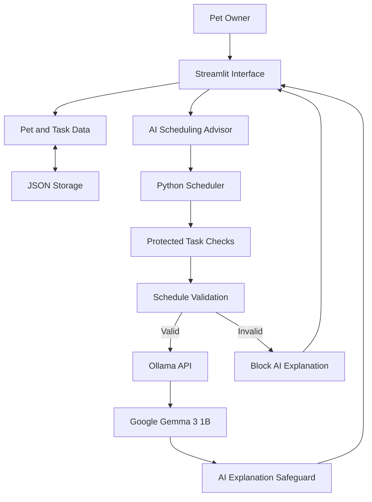

# PawPal+ — AI110 Applied AI Final Project

**Project:** AI-Assisted Pet Care Scheduling  
**Course:** CodePath AI110  
**AI Model:** Google Gemma 3 1B, running locally through Ollama  
**Repository:** https://github.com/bhanujain2008-hub/pawpal-applied-ai-final

## 1. Project Overview

PawPal+ is a Streamlit application that helps pet owners organize care tasks for multiple pets.

The original Module 2 project provided task management, scheduling, conflict detection, recurrence, and JSON persistence.

For the AI110 final project, PawPal+ was extended with an **AI Scheduling Advisor** that combines deterministic Python scheduling, safety validation, and a locally hosted language model.

**Design principle:** Python determines the schedule. Gemma explains it. AI-generated explanations never modify saved tasks.

## 2. Original PawPal+ Features

- Manage an owner and multiple pets.
- Add tasks with descriptions, dates, times, durations, priorities, and recurrence frequencies.
- Sort tasks by time or priority.
- Filter by pet or completion status.
- Detect overlapping task intervals.
- Mark tasks completed.
- Generate subsequent daily or weekly recurring tasks.
- Save and restore data using local JSON storage.
- Display schedules and warnings in Streamlit.

### Core Classes

| Class | Responsibility |
|---|---|
| `Owner` | Manages pets and their tasks. |
| `Pet` | Stores pet details and care tasks. |
| `Task` | Stores task descriptions, times, durations, priorities, recurrence, and completion. |
| `Scheduler` | Sorts, filters, detects conflicts, and handles recurrence. |

Original UML diagrams are preserved in `diagrams/`.

## 3. New Applied AI Feature

The **AI Scheduling Advisor** integrates Google Gemma 3 1B with the existing PawPal+ application.

### Processing Workflow

1. The owner enters pet-care tasks through Streamlit.
2. Python retrieves incomplete tasks and orders them by their original scheduled times.
3. Protected tasks, including medication and injections, retain their original times.
4. Flexible tasks are moved when necessary to avoid protected intervals and other scheduled flexible tasks.
5. Python validates task durations, protected times, and overlaps.
6. Invalid schedules block AI explanation.
7. Valid schedules are sent to Gemma through the local Ollama API for an advisory explanation.
8. A basic phrase-based safeguard rejects certain unsupported AI claims.
9. Streamlit displays the proposed schedule, validation results, and any available explanation.

The advisor **does not automatically overwrite the owner's saved tasks**.

### Architecture

Source diagram: `diagrams/architecture.mmd`



## 4. Installation and Setup

### Requirements

- Python 3
- Windows PowerShell or another supported terminal
- Ollama
- Google Gemma 3 1B model
- Python dependencies from `requirements.txt`

### Install Python Dependencies

```powershell
python -m venv .venv
.venv\Scripts\Activate.ps1
python -m pip install -r requirements.txt
```

### Install and Prepare Ollama

Install Ollama from https://ollama.com.

Download the model:

```powershell
ollama pull gemma3:1b
```

Ensure Ollama is running locally and serving requests at:

`http://localhost:11434`

### Run PawPal+

```powershell
python -m streamlit run app.py
```

Open the URL displayed by Streamlit, usually:

`http://localhost:8501`

To run the original command-line demonstration:

```powershell
python main.py
```

### Run Tests

```powershell
python -m pytest -q
```

**Latest verified result: 17 passed.**

The Python scheduling and validation features remain usable without Ollama. AI explanations require Ollama and the downloaded Gemma model.

## 5. Actual Input/Output Examples

These examples are drawn from tests and observed application behavior.

### Example 1 — Two Overlapping Walks

**Input:**

| Task | Original Time | Duration |
|---|---|---|
| Morning walk | 8:00 AM | 20 minutes |
| Second walk | 8:00 AM | 20 minutes |

**Python-generated output:**

| Task | Proposed Start | End |
|---|---|---|
| Morning walk | 8:00 AM | 8:20 AM |
| Second walk | 8:20 AM | 8:40 AM |

**Result:** Validation passed. The tasks do not overlap, and their durations are preserved.

### Example 2 — Walk Overlapping Medication

**Input:**

| Task | Original Time | Duration |
|---|---|---|
| Walk | 8:00 AM | 20 minutes |
| Medication | 8:10 AM | 10 minutes |

**Python-generated output:**

| Task | Proposed Start | End | Status |
|---|---|---|---|
| Medication | 8:10 AM | 8:20 AM | Requires human review |
| Walk | 8:20 AM | 8:40 AM | Proposed |

**Result:** Validation passed. The medication time remained unchanged, and the walk was moved.

Medication timing still requires appropriate human review.

### Example 3 — Conflicting Protected Tasks

**Input:**

| Task | Original Time | Duration |
|---|---|---|
| Medication | 8:00 AM | 20 minutes |
| Insulin injection | 8:10 AM | 10 minutes |

**Observed output:**

```text
VALIDATION: (False, 'Overlapping tasks: Medication and Insulin injection')
```

**Result:** Both original protected times were preserved. Python detected the overlap and blocked AI explanation.

## 6. Model Evaluation and Reliability Findings

### Initial Model Behavior

Gemma 3 1B was tested directly on scheduling problems before adding deterministic safeguards.

**Failure 1 — Incorrect Task Durations**

For two 20-minute tasks scheduled at 8:00 AM, Gemma proposed:

```text
7:40 AM - 7:50 AM: Dog's Walk (20 minutes)
7:50 AM - 8:00 AM: Feeding (20 minutes)
```

The intervals were only 10 minutes each, contradicting the stated durations.

**Failure 2 — Incorrect Sequential Scheduling**

When explicitly instructed to schedule two 20-minute tasks sequentially without overlap or shortening, Gemma proposed:

```text
8:00 AM - 8:20 AM: Task 1
8:20 AM - 8:22 AM: Task 2
```

The second task was shortened to two minutes.

**Failure 3 — Invented Activities**

For a schedule containing only one walk, Gemma described additional activities and claimed the tasks gradually increased in duration.

In a separate empty-schedule test, Gemma invented veterinary appointments and examinations.

**Failure 4 — Unsupported Priority Claim**

During the Streamlit demonstration, Gemma described an evening walk as the "most important" task, although the scheduling algorithm had not established that ranking.

### Engineering Response

These observations motivated the following changes:

- Python calculates task intervals instead of relying on LLM arithmetic.
- Python validates durations and overlapping intervals.
- Protected tasks cannot be moved automatically.
- Invalid or empty schedules block AI explanations.
- Gemma receives a validated schedule rather than being asked to construct one.
- A basic phrase filter rejects several observed unsupported claims.
- AI explanations are clearly labeled advisory.

### Remaining Limitations

The phrase filter is **not a comprehensive hallucination detector**. Gemma may still introduce unsupported statements that do not match the filtered phrases.

Additional limitations include:

- Protected tasks are identified using description keywords.
- The scheduler does not understand clinical urgency or veterinary requirements.
- A valid schedule may still be impractical for the owner.
- The current scheduler does not optimize travel, owner availability, or task priority.
- Protected-task conflicts require human intervention.
- Ollama must be available to generate AI explanations.
- Proposed schedules are not automatically saved.

Further model risks, intended uses, and evaluation findings are documented in `model_card.md`.

## 7. Testing

The project uses pytest for automated verification.

### Original Module 2 Tests

**11 tests** cover core PawPal+ functionality, including scheduling, filtering, recurrence, storage, and conflict detection.

### Final Project AI Reliability Tests

**6 additional tests** cover:

1. Rescheduling overlapping walks.
2. Preserving task durations.
3. Protecting medication times.
4. Rejecting overlapping medication tasks.
5. Rejecting empty schedules.
6. Rejecting incorrectly shortened task intervals.

### Verified Test Output

```text
.................                 [100%]
17 passed in 0.08s
```

These tests verify deterministic scheduling behavior. They do not constitute a comprehensive evaluation of Gemma's natural-language explanations.

## 8. Safety and Privacy

- Medication and other keyword-identified protected tasks retain their original times.
- Conflicting schedules block AI explanations.
- The application does not provide veterinary medical advice.
- The proposed schedule is not automatically written over the owner's saved schedule.
- Gemma runs locally through Ollama rather than requiring a cloud LLM API.
- Pet and task information is stored locally in JSON.
- The local data file `pawpal_data.json` is excluded from Git through `.gitignore`.

Local execution does not by itself guarantee complete privacy or security. Users should still protect their devices and stored data.

## 9. AI Collaboration and Development Decisions

AI tools assisted with code development, troubleshooting, tests, and documentation.

### Accepted Recommendation

Use deterministic Python scheduling and validation before asking the language model to explain results.

**Reason:** Direct Gemma tests demonstrated incorrect duration arithmetic and invented details.

### Revised Recommendation

An initial scheduler moved overlapping flexible tasks without adequately protecting medication intervals.

**Revision:** Protected intervals are now reserved first, and flexible tasks are moved around them. Protected conflicts remain subject to human review.

### Additional AI Collaboration

The original Module 2 project also documented GitHub Copilot Agent development and a comparison of broad versus specific prompts.

See `ai_interactions.md` for that earlier collaboration record.

All generated code and explanations require developer verification; AI suggestions are not assumed correct.

## 10. Project Files

| File | Purpose |
|---|---|
| `app.py` | Streamlit application and AI advisor interface |
| `pawpal_system.py` | Owner, Pet, Task, and Scheduler classes |
| `ai_advisor.py` | Scheduling safeguards, validation, and Ollama integration |
| `storage.py` | Local JSON persistence |
| `main.py` | Original command-line demonstration |
| `test_ai_advisor.py` | Six AI reliability tests |
| `tests/test_pawpal.py` | Eleven original tests |
| `diagrams/architecture.mmd` | Applied AI architecture diagram |
| `diagrams/uml_draft.mmd` | Original draft UML |
| `diagrams/uml_final.mmd` | Original final UML |
| `diagrams/uml.mmd` | Additional UML diagram |
| `model_card.md` | Model capabilities, evaluation, and limitations |
| `ai_interactions.md` | Earlier AI collaboration documentation |
| `reflection.md` | Project reflection |
| `requirements.txt` | Python dependencies |
| `.gitignore` | Git exclusions |

## 11. Demonstration Guide

A 5–7 minute presentation can demonstrate:

1. The original PawPal+ features and project motivation.
2. Adding a pet and care tasks in Streamlit.
3. Running the AI Scheduling Advisor.
4. Viewing a validated schedule and Gemma explanation.
5. Demonstrating overlapping tasks and protected medication handling.
6. Showing the 17 passing tests.
7. Explaining Gemma's observed errors, the safeguards, and remaining limitations.

## 12. Project Status

**GitHub repository:**  
https://github.com/bhanujain2008-hub/pawpal-applied-ai-final

**Verified AI implementation commit:** `5cb7ef7`

**Latest verified automated test result:** 17 passed.

The AI advisor has been implemented, tested locally, and pushed to GitHub. Final documentation and submission preparation are being completed.

Final grading is determined by CodePath.
